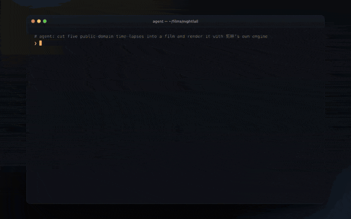

<div align="center">

# jianying-agent-cli（`jy`）

**给 AI agent 用的无界面视频剪辑命令行：ffmpeg 本地剪辑 + 可选调用你本机的剪映专业版原生渲染。**

裁剪、拼接、字幕、标题、转场、滤镜、抠图、音频、关键帧、批量导出——每次调用只输出一个 JSON 对象，Claude Code、Codex 或任何脚本都能直接驱动，不用开 GUI。

[](https://github.com/JNHFlow21/jianying-agent-cli/actions/workflows/test.yml)
[](LICENSE)


[](https://github.com/JNHFlow21/jianying-agent-cli/stargazers)

[English](README.md) · 简体中文



<sub>由剪映自己的引擎渲染：<code>jy draft build</code> + <code>jy render</code> 无界面驱动剪映，用的是真正的剪映转场、滤镜、特效和文字动画；素材是美国国家公园管理局的公有领域延时摄影 — <a href="docs/DEMO-CREDITS.md">素材署名</a> · <a href="docs/demo.mp4">MP4 版</a></sub>

</div>

## 亮点

- **无界面**：不开窗口、不点鼠标、不动指针，没人看着的机器也能跑。
- **为 agent 设计**：stdout 永远只有**一个 `jy.v1` JSON 对象**；`ok` 是唯一成功判据，错误带错误码和 `retriable`；ffmpeg 日志只走 stderr。
- **结果可信**：每个产出文件的命令都会用 ffprobe 回验，`ok:true` 就意味着真有一个能播放的文件。
- **39 个命令**（含子命令 56 个）：探测、裁剪、拼接、变速、蒙太奇/踩点、字幕、ASS 文字动画、50+ 转场、滤镜/LUT、曲线/HSL、色度抠图、画中画、BGM 混音/闪避/响度、本地语音转字幕、封面、GIF、批量导出、后台任务。
- **双引擎**：默认**本地引擎**（ffmpeg，离线、结果确定）；**剪映引擎**把草稿交给你已经安装的剪映渲染，用剪映自己的素材。
- **能找、能下剪映素材**：`jy effects search-remote 推近` 搜剪映已知的素材，`jy effects fetch 推近` 把素材包下载进剪映缓存（校验 md5、原子写入）；spec 里直接写 `"transition":{"name":"推近"}`，`jy draft build --fetch` 按名字解析并自动下载。
- **听得懂剪映话**：`jy transition --type 叠化`、`jy filter --preset 日系`，剪映中文名会映射到本地实现，并如实报告接近程度（`fidelity: exact | close | rough`）。
- **零 Python 依赖**：只用标准库 + ffmpeg；自带 [agent skill](skills/jianying-native/SKILL.md)，你的 agent 装上就会用。

## 安装

```sh
git clone https://github.com/JNHFlow21/jianying-agent-cli.git && cd jianying-agent-cli && python3 install_global.py
```

需要 Python 3.9+ 和 ffmpeg。推荐 `brew install ffmpeg-full`（带 libass 字幕、x264/x265、zimg）；普通 `ffmpeg` 也能用，缺的能力会明确报出来，不会假装支持。安装器把 `jy` 软链到 `~/.local/bin`（那里已有的非 `jy` 文件会先改名为 `jy.bak-<时间>`，不会删除）。然后：

```sh
jy doctor     # 看 ffmpeg 构建、能力矩阵和剪映引擎状态
```

## 快速上手

```sh
jy probe a.mp4 b.mp4                                   # 编码/分辨率/帧率/时长/音轨 + 能否直接拼接
jy trim a.mp4 --start 4 --duration 8 -o seg.mp4
jy concat seg.mp4 b.mp4 -o rough.mp4                   # 规格一致直接流拷贝，否则自动归一化
jy transition a.mp4 b.mp4 --type 叠化 --duration 0.5 -o joined.mp4
jy text joined.mp4 --content "标题" --position top --animation slideup -o titled.mp4
jy subtitle titled.mp4 --srt subs.srt --style cinematic -o subbed.mp4
jy export subbed.mp4 -o final.mp4 --resolution 1080p --fps 30 --quality 20 --faststart
jy frame final.mp4 --at 50% -o check.jpg               # 交付前抽帧看一眼
```

失败时也只输出一个 JSON：

```json
{"schema":"jy.v1","command":"export","ok":false,"outcome":"unknown","data":null,
 "error":{"code":"NOT_FOUND","message":"input not found: missing.mp4","retriable":false,"details":{}},
 "warnings":[],"meta":{"ffmpeg":"/opt/homebrew/opt/ffmpeg-full/bin/ffmpeg","elapsed_ms":3}}
```

## 配合 Claude Code / Codex / 其他 agent 使用

仓库自带一个 [Agent Skill](skills/jianying-native/SKILL.md)（使用规则、`jy.v1` 输出格式、常用配方、限制），以及通用的 [AGENTS.md](AGENTS.md)。

```sh
python3 install_global.py --with-skill     # 把 skill 复制到 ~/.claude/skills 和 ~/.agents/skills（已有的先备份）
# 或者用 skills 命令行：
npx skills add JNHFlow21/jianying-agent-cli
# 或者手动复制：
cp -r skills/jianying-native ~/.claude/skills/     # Claude Code
cp -r skills/jianying-native ~/.agents/skills/     # Codex 等支持 Agent Skills 的工具
```

然后直接说：*"把这三段素材剪成 15 秒竖屏视频，加标题和字幕。"* agent 会调用 `jy`，按 `ok` / `error.code` 分支，交付前自己抽帧检查。

## 命令一览

| 分类 | 命令 |
|---|---|
| 检查 | `doctor` `probe` |
| 剪辑 | `trim` `concat` `speed` `reverse` `rotate` `flip` `crop` `montage` `beats` `overlay` |
| 画面 | `transition` `filter` `adjust` `curves` `hsl` `hdr` `mix` `key` `beautify` |
| 文字与字幕 | `text` `subtitle`（烧录 / 导出 SRT）`asr`（本地 whisper.cpp） |
| 音频 | `audio`（音量、淡入淡出、BGM 混音/替换、闪避、响度、降噪）`extract-audio` |
| 导出 | `export` `gif` `frame` `cover` `batch` |
| 剪映引擎 | `draft build` `render` `effects list/search/params` `material status/register` `fonts` |
| 工程管理 | `draft list/rename/duplicate/delete/move/history` `asset import/list/prune` |
| 无人值守 | `--async` + `jobs list/status/wait/kill` `clean` |

完整参考：[USAGE.md](USAGE.md) · `jy <命令> --help` · [docs/CLI-HELP.txt](docs/CLI-HELP.txt) · 逐命令长篇说明 [docs/REFERENCE.zh-CN.md](docs/REFERENCE.zh-CN.md)。

## 工作原理

```
             ┌── 本地引擎 ──▶ ffmpeg / ffprobe（argv 列表，不经 shell）──▶ out.mp4（回验）
jy <命令> ───┤
             └── 剪映引擎 ──▶ jy draft build ─▶ draft_info.json（明文 JSON）
                              jy render ─────▶ 剪映的本地 bridge（127.0.0.1，每次启动换 token）
                                               ─▶ 剪映自己的导出器 ─▶ out.mp4（回验）
```

- **本地引擎**：自动挑本机能力最全的 ffmpeg，校验每个参数，生成滤镜图，执行后回验结果。
- **剪映引擎**：把时间线写成明文剪映草稿，请**正在运行**的剪映通过它自己开放的本地 bridge 导出。不做界面自动化、不动指针；剪映抢前台时，焦点守卫会把前台还给你原来的 app。协议说明见 [docs/BRIDGE.md](docs/BRIDGE.md)。
- `jy` 本身**不发任何网络请求**。剪映可能连自己的服务器（下载素材），那是剪映的流量。

## 能做什么，不能做什么（实话）

| 能力 | 现状 |
|---|---|
| 本地剪辑、编码、字幕、文字、转场、调色、抠图、音频、批量 | 离线可用；`tests/smoke.sh`（260 项检查）在 macOS CI 上跑 |
| 剪映中文转场/滤镜名 | 映射到 ffmpeg 近似实现，每条都标注接近程度——**不是**剪映素材库原版 |
| `beautify` | 全局柔肤效果，**不是**人脸识别美颜 |
| `key` | 单色色度抠图，**不是**智能抠像 |
| `asr` | 只用本地 whisper.cpp；没装二进制/模型就报 `UNSUPPORTED`；从不上传音频 |
| 剪映渲染视频片段 + 带样式文字 | 在 macOS 剪映专业版 11.6 上验证（逐帧对比） |
| 剪映素材（特效、转场、滤镜、贴纸、花字、美颜、抠像、关键帧、蒙版、色轮、文字动画） | 草稿结构与剪映 GUI 自己写的一致；在作者机器上、素材已缓存的前提下逐帧像素验证。素材没缓存时可能**无报错地**没效果或黑帧——一定要抽帧检查 |
| VIP / SVIP 素材 | 需要你自己的会员。`jy` 会点名被拒的素材，绝不绕过会员限制 |
| HDR tone mapping | 只在本机 zimg 支持时可用，否则 `UNSUPPORTED` |
| Windows / Linux | 未测试。剪映引擎只支持 macOS |
| 上传 / 发布到平台 | 不在范围内 |

## 常见问题

**怎么用 Claude Code 或其他 AI agent 剪视频？**
安装 `jy` 和它的 skill（`python3 install_global.py --with-skill`），然后用大白话描述你要的剪辑。agent 会调用 `jy` 命令，每条返回一个 JSON，它能检查 `ok`、读 `data.output`（时长、尺寸、编码），只在 `error.retriable` 为 true 时重试。

**能不开剪映界面就自动化剪映 / CapCut 吗？**
部分可以。凡是 ffmpeg 能做的，完全不需要剪映。要用剪映自己的素材时，`jy draft build` + `jy render` 会通过本地 bridge 把草稿交给正在运行的剪映桌面版——不点界面、不用操作窗口——但剪映必须开着并且已登录。

**需要剪映 VIP 会员吗？**
本地引擎不需要，它根本不用剪映。剪映引擎遵守剪映自己的规则：VIP/SVIP 素材需要你的会员，`jy` 会告诉你是哪一项被拒（`BLOCKED`）。加 `--on-entitlement local` 可以改用本地近似重渲染，并逐条列出降级了什么。

**支持 CapCut 国际版吗？**
目标是 macOS 版剪映专业版（`/Applications/VideoFusion-macOS.app`）。本地引擎与任何 app 无关。CapCut 国际版未测试。

**我的 AI agent 怎么学会用 `jy`？**
通过 [skills/jianying-native/SKILL.md](skills/jianying-native/SKILL.md)（Claude Code、Codex 等支持 Agent Skills 的工具）和 [AGENTS.md](AGENTS.md)（任何会读仓库说明的 agent）。两者都把 `jy doctor` 和 `jy <命令> --help` 当作最终依据。

**在真实项目上用安全吗？**
没有 `--force` 绝不覆盖输出；输入只读；草稿管理命令默认只预览，加 `--apply` 才动手，动手前先备份剪映索引；`render` 只渲染 `jy` 自己生成的草稿；bridge 的 token 从不落盘、不进日志。

**为什么不直接用 ffmpeg？**
当然可以。`jy` 补上的是 agent 最容易踩坑的部分：参数校验、滤镜转义、能力探测、拼接归一化、输出回验、稳定的 JSON 契约和后台任务。

## 卸载

```sh
rm ~/.local/bin/jy
rm -rf ~/.claude/skills/jianying-native ~/.agents/skills/jianying-native   # 如果装过 skill
rm -rf ~/.cache/jy                                                         # 任务记录与临时草稿
```

再删掉克隆的目录即可。`~/Movies/jy-staging` 只有用过剪映引擎才会有（`jy clean --staging --apply` 可删）。

## 开发

```sh
./tests/smoke.sh                     # 用合成素材跑端到端测试；剪映没运行时相关检查自动跳过
JY_SMOKE_RENDER=1 ./tests/smoke.sh   # 额外跑一次真实剪映导出（需要剪映在运行）
python3 docs/render_demo.py          # 重新生成 docs/demo.gif 和 demo.mp4（需要剪映在运行；--engine local 只用 ffmpeg；需要 Chrome、ffmpeg、jq、gifsicle）
```

## 声明

这是一个非官方的独立工具，与字节跳动、剪映 / JianyingPro、CapCut 没有任何关联，也未获其认可或赞助。所有商标归各自所有者。剪映引擎只驱动你自己安装并登录的剪映，并遵守剪映自身的权益规则。

---

如果 `jy` 帮你省下了一下午查 ffmpeg 参数的时间，点个 ⭐ 能让更多人（和他们的 agent）找到它。

[](https://star-history.com/#JNHFlow21/jianying-agent-cli&Date)

[MIT](LICENSE)
